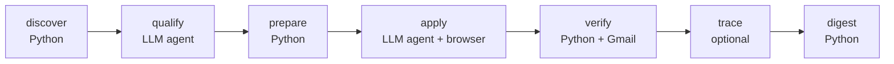

# job-harness

A daily job-application pipeline: discover postings, have an LLM agent qualify them against **your** rules,
tailor a keyword-verified resume per posting, let a browser agent submit the applications, check each one
against the confirmation email, and post a summary. Deterministic Python does everything except two judgement
steps (qualify, apply), so a bad model call cannot corrupt state.



## Read this first: this is one person's Windows tool, published as a starting point

This repo is **not** a generic product you configure with a settings file. It is a working system built on one
Windows 11 machine for one person's job search, then published so that **your own coding agent can adapt it to
you and your machine**. That adaptation is expected: it costs your agent some tokens and a few hours of your
attention, and this README lists every place the author's assumptions are baked in.

Three kinds of author-specific assumptions exist:

1. **Platform: Windows only, as shipped.** It has run daily only on Windows 11 with Python 3.13. Nothing here has been run on macOS or Linux, and `daily.py` will not even start there. See [Platform: Windows-only as shipped](#platform-windows-only-as-shipped).
2. **Personal job goals:** title lists, blocklists, resume variants and routing rules are tuned to the author's target roles. See [What is tuned to the author](#what-is-tuned-to-the-author).
3. **Vendor choices:** discovery uses a metered third-party gateway, receipts are read from Gmail, the agent runtime is `omp`, outreach uses the author's private TraceHire Worker. See [External services](#external-services).

## Two agents, two jobs (do not confuse them)

| Role | What it does | Which tool |
|---|---|---|
| **Setup agent** | Reads this README once, adapts the code and config to you and your OS, interviews you for your facts. | Any coding agent: Claude Code, Codex, omp, Cursor... |
| **Runtime agent** | Runs unattended every day: `omp -p` executes `pipeline/prompts/qualify.md` and `apply.md`. | [`omp`](https://github.com/can1357/oh-my-pi) (Oh My Pi), logged in to a Claude or ChatGPT/Codex subscription or an API key. |

The prompts name omp-specific tools (`workpool`, a browser tab API with `tab.evaluate`, bash). Running the
pipeline under a different runtime means rewriting those two prompts and the `agent()` function in
`pipeline/daily.py`. Using a different agent *for setup only* needs nothing.

## If you are an AI agent: bootstrap protocol

Work through these gates in order. Each has a check. Tell the human what a step costs before you run anything metered.

**Rules you must follow**

1. **Never invent facts about the human.** Name, contact details, work history, dates, metrics, skills, work authorization and salary expectations come from the human, one question at a time. Write only what they confirm. The resume variants, `blitz_answers.md` and `keyword_facts.json` are the only sources the apply agent may type into a form; a wrong line there is submitted to employers under their name.
2. **Tell the human the price before any metered call.** `discover` costs about **$0.0005 per returned posting** (the estimate in `discover.py`). `qualify` and `apply` spend model tokens: roughly one agent session per candidate. Cap them with `limits` in `config.json` before the first live run.
3. **Never commit private files.** `.gitignore` is an allowlist: only code, prompts, `RUNBOOK.md` and this README are tracked. Before every push run `git grep -n -i -E "<their name>|<their email>|<their phone>"` and read the staged diff.
4. **Do not enable the apply stage until the human has reviewed qualify output.** First runs use `--no-apply`. Applications are real, sent in the human's name, and cannot be recalled.
5. **Say what you could not verify.** If you port a code path to the human's OS, say whether you ran it.

**Gate 0. Interview the human (no spend).** Ask for and record: OS, target roles and titles, locations and remote
rules, salary floor, companies or industries to exclude, work authorization, what they refuse to do on a form
(cover letters, exact-salary fields, AI-attestations, account creation), and which accounts they have (Gmail?
Discord? a Claude or ChatGPT subscription?).

**Gate 1. Install prerequisites.**

| Need | Why | Install |
|---|---|---|
| Python 3.9+ (author uses 3.13) | all deterministic stages | python.org, `brew install python`, or your distro. Use `python3` where `python` is absent. |
| `pip install -r requirements.txt` | `fpdf2` renders resume PDFs | in a venv if you like |
| `omp` CLI | runtime agent | macOS/Linux: `curl -fsSL https://omp.sh/install \| sh`; Windows: `irm https://omp.sh/install.ps1 \| iex`; or `bun install -g @oh-my-pi/pi-coding-agent` |
| An omp login | model access | `omp login anthropic` (Claude subscription) or `omp login openai-codex` (ChatGPT/Codex subscription); `omp models` lists what you can use |
| Node.js + Google Workspace CLI `gws` (`@googleworkspace/cli`) | verify stage reads Gmail receipts; apply agent reads emailed security codes | `npm i -g @googleworkspace/cli`, then authenticate it to the Gmail account used on applications. **Gmail only**; for other mail providers replace `verify.py` |
| A [treg](https://treg.to/?ref=anthonyxge19-8jtx5) account | `discover.py` gets job postings through treg's BlitzAPI search; this is the one stage with no free substitute here | sign up, add a little credit (a first discovery run costs cents), then `treg login` so `~/.treg/config.json` exists with `base_url`, `token`, `active_org`. The link is the author's referral link. |

Check: `python --version`, `omp --version`, `omp models`, `~/.treg/config.json` exists, and a Gmail call through `gws` that returns JSON.

Subscription logins are meant for interactive use; this pipeline drives them unattended and can burn a lot of
quota. Read your provider's terms on automated use before relying on it, and prefer an API key if in doubt.

**Gate 2. Create the private inputs.** All are untracked. There are no template files; the formats are below.

| Create | Used by | Contents |
|---|---|---|
| `pipeline/config.json` (copy `pipeline/config.example.json`) | every stage | search profile, caps, notification settings; see [Config](#config) |
| `resume_GTM.txt`, `resume_FDE.txt`, `resume_AI.txt`, `resume_TOOLS.txt`, `resume_AI-HEALTH.txt` in the repo root | `prepare` | your resume as plain text, **all five names required** unless you edit the code; see [Resume file contract](#resume-file-contract) |
| `keyword_facts.json` | `prepare` | which skills you may claim; see [keyword_facts.json](#keyword_factsjson) |
| `blitz_answers.md` | `qualify`, `apply` | the only facts the agent may type into forms: legal and preferred name, email, phone, address, links, work authorization, sponsorship need, start date, salary range, current-employer wording, background-check consent, EEO answers (default: decline) |
| `profile/qualify_rules.md` | `qualify` | your binding SKIP / ESCALATE / APPLY rules, location rule, salary rule, exclusions |
| `profile/apply_rules.md` | `apply` | standing answers, consents, whether account creation or third-party sign-in is allowed, what to escalate |
| `resume_routing_context.md` | `qualify` | the author's playbook, which `qualify.md` tells the agent to read ("sections 3, 6, 7, 9"). Either write one with those numbered sections (hard routing, location/comp, skip/escalate, truthfulness) or delete that line from `qualify.md` |
| `routing.json` (optional) | `resume_tailor` | `{"routing": {...}, "title_overrides": {...}}`; may be omitted |

**Gate 3. Adapt the code to the human and their OS.** Walk the [tuned-to-the-author table](#what-is-tuned-to-the-author)
and the [Windows-only list](#platform-windows-only-as-shipped), confirm each item with the human, and edit. Mandatory for everyone:
the absolute paths in `config.json` and the two prompts, the model pins in `omp-pipeline.yml`, `query.titles`/`searches`,
the regexes in `discover.py`, `VARIANTS`/`decide_variant()`, the Gmail check in `resume_tailor.py`, and the escalation list
in `prompts/apply.md`. Everyone not on Windows also ports the lock, the scheduler and the paths.

**Gate 4. Offline checks (free).**

```sh
python pipeline/discover.py --dry-run          # prints the search payloads, calls nothing
python pipeline/ledger.py list --days 7        # state.db opens and the schema creates
python pipeline/watchdog.py                    # reports "no heartbeat file" before the first run: expected
```

**Gate 5. Metered but harmless: discovery only.** `python pipeline/daily.py --discover-only` calls the job gateway
(about $0.0005 per returned posting), uses no LLM and no browser. Read `pipeline/state/candidates-latest.json` and
`pipeline/state/dropped-<date>.json` with the human. Tune the blocklists until both look right.

**Gate 6. Qualify and tailor, no submissions.** `python pipeline/daily.py --no-apply --no-trace` spends model tokens on
`qualify`, then renders resumes. Review `state/verdicts/<date>.json`, the PDFs in `resumes/`, and the digest in
`state/digest-<date>.md` with the human. Every verdict reason should be one the human agrees with.

**Gate 7. Supervised apply.** Set `limits.max_applications_per_day` to 1 to 3 and run `python pipeline/daily.py --no-trace`.
Watch `state/evidence/<key>.json` and the confirmation emails. Count an application as submitted only when `verify`
shows a receipt. Raise the cap gradually.

**Gate 8. Schedule.** See [Scheduling](#scheduling). The machine must be awake and logged in at run time.

## Quick start for a human (no agent)

Realistically, point your coding agent at this repo and say "follow the README". Doing it by hand means every item
in Gates 1 to 3, including editing code, so the agent route is the supported one.

[`pipeline/RUNBOOK.md`](pipeline/RUNBOOK.md) documents stages, caps, guards and the state schema in depth, but it is
the author's Windows ops log (`C:/` paths, Task Scheduler, dated incidents): **where it disagrees with this README, this README wins.**

## How the pipeline works

| Stage | Run by | What it does | Output |
|---|---|---|---|
| discover | `discover.py` | job search through the gateway; drops anything already decided, agencies and blocked titles | `state/candidates-latest.json`, `state/dropped-<date>.json` |
| qualify | `omp -p` with `prompts/qualify.md` | reads each JD, finds the employer's own application URL, applies your rules, saves the JD text | `state/verdicts/parts/<date>/*.json`, merged to `verdicts/<date>.json` |
| prepare | `prepare.py` + `resume_tailor.py` | routes each APPLY verdict to a resume variant, adds JD keywords you may truthfully claim, renders a PDF | `resumes/`, `state/apply-queue.json` |
| apply | `omp -p` with `prompts/apply.md` | fills and submits forms in a browser, writes proof or an escalation | `state/evidence/<key>.{json,png}` |
| verify | `verify.py` | matches Gmail receipts to applications; anything unproven is downgraded to `unverified` | `state.db` |
| trace | `trace.py` | OPTIONAL: starts outreach drafts through TraceHire | `state.db` |
| digest | `digest.py` | one markdown summary, optionally posted to Discord | `state/digest-<date>.md` |

`state/state.db` (SQLite) is the source of truth. `python pipeline/ledger.py check|list|add|outreach|lead|resume-change`
reads and appends to it, including applications you made by hand. A day with zero candidates still runs verify, trace and
digest. A failed stage stops the run but still sends a digest. A lock file prevents overlapping runs. There are **no agent
timeouts**: a hung agent blocks that day's run until you kill it.

## Config

`pipeline/config.json` (copy of `config.example.json`). **Every path in it must be absolute** and `harness`,
`state_dir`, `notify.email` and `gws` are required; nothing is resolved relative to the repo.

| Key | Meaning |
|---|---|
| `harness` | absolute path of this repo's root (where `resume_*.txt` live) |
| `state_dir` | absolute path of `pipeline/state` |
| `resume_prefix` | PDF filename prefix, e.g. `Jane_Doe_Resume` gives `Jane_Doe_Resume_<key>.pdf` |
| `query.titles`, `query.searches` | title keywords and the searches to run (remote, plus local hybrid/on-site by city) |
| `query.exclude_hq_cities`, `date_posted_days`, `is_agency`, `page_size`, `max_pages_per_search` | filters and paging |
| `limits.max_candidates`, `max_applications_per_day`, `max_trace_runs_per_day`, `max_captcha_solves_per_day` | hard caps. `max_applications_per_day` counts attempts queued, not confirmed submissions. The default 50 is high for a first run |
| `notify.email` | **your** mailbox address; mail from yourself is excluded when matching receipts |
| `notify.discord_*` | optional; without them the digest is only the local file |
| `gws.node`, `gws.cli` | absolute path to `node` and to `@googleworkspace/cli/run-gws.js`. The author launches gws as `node run-gws.js` because the Windows `.cmd` shim mangles JSON arguments. On macOS/Linux change `verify.py` to call `gws` directly |
| `tracehire` | read at import by `trace.py` (needs `base` and a `key_file` that exists). Without a TraceHire deployment run with `--no-trace`; otherwise the trace stages fail non-fatally on every run |

Set `JOBHUNT_STATE=<dir>` to run any stage against a copy of `state/`.

## Resume file contract

Five files in the repo root, named exactly `resume_GTM.txt`, `resume_FDE.txt`, `resume_AI.txt`, `resume_TOOLS.txt`,
`resume_AI-HEALTH.txt` (the names are hard-coded in `VARIANTS` in `resume_tailor.py`). `prepare.py` picks one with
`decide_variant()`, which routes on title and JD keywords to those five names and crashes if the chosen file is missing.
**Simplest adaptation:** edit `VARIANTS` and `decide_variant()` down to the variants you really have, even one. Plain
text, UTF-8:

```
Line 1: your name
Line 2: headline (replaced with the job's own title in each tailored copy)
Line 3: contact line; MUST contain the literal text "gmail.com" (hard-coded sanity check in tailor(); change it to "@")
Then sections whose headings are exactly: SUMMARY, EXPERIENCE, PROJECTS, EDUCATION, SKILLS
"* " starts a bullet. "Employer  |  Role  |  dates" lines render as bold entry headers.
"Label: a, b, c" lines (in SKILLS) render with a bold label.
```

At least 5 lines are required. The PDF renderer is hard-coded to those five headings and a built-in Latin-1 font, so
characters outside Latin-1 become `?`. Edit `render_pdf()` for another layout or alphabet.

**Know what the keyword engine does.** For each posting it finds the keywords the JD names and guarantees 100% of them
appear on the generated resume. Skills in `keyword_facts.json` with tier A and a written `basis` go on an `Also:` line.
Tier B/C skills and every *unmapped* JD term go on an `Also familiar with:` line **even if you have no experience with
them**. That was the author's deliberate keyword-match strategy. If you do not want unverified terms on your resume,
change the `familiar_missing` handling in `tailor()`; decide this with the human at Gate 3 and never leave it as an
unexamined default.

### keyword_facts.json

```json
{
  "entries": {
    "python":     {"aliases": ["Python", "Python 3"],   "tier": "A", "basis": "Wrote production services in Python for 5 years."},
    "kubernetes": {"aliases": ["Kubernetes", "K8s"],    "tier": "B", "basis": "Deployed to a team-run cluster; did not administer it."},
    "clearance":  {"aliases": ["security clearance"],   "tier": "C", "basis": null}
  }
}
```

Tier A = real hands-on experience, claimable once `basis` says what you did. Tier B = adjacent exposure. Tier C = never
claim. An entry in tier A or B with `basis: null` is BLOCKED and the engine will not claim it. The first alias is the
spelling written onto the resume. `python keyword_coverage.py --jd FILE.txt --variant resume_X.txt` reports coverage for one JD.

## Platform: Windows-only as shipped

Verified: Windows 11, Python 3.13, daily since 2026-10-29. **Not run on macOS or Linux, and known not to start
there.** Adapting it is the setup agent's job. Everything Windows-specific:

| Where | Windows assumption | What a port does |
|---|---|---|
| `pipeline/daily.py` line `import msvcrt` and the `msvcrt.locking(...)` call | single-run lock; `msvcrt` does not exist on macOS/Linux, so the orchestrator fails on import | use `fcntl.flock(f, LOCK_EX \| LOCK_NB)` on POSIX |
| `pipeline/daily.bat`, `watchdog.bat`, `daily-hidden.vbs`, `watchdog-hidden.vbs`, `register-tasks.bat` | hard-coded `C:\Python313\python.exe` and `C:\tmp\jobharness\pipeline\...`; Task Scheduler (`schtasks`) with a `wscript` wrapper to avoid a console flash | write a cron entry or a launchd LaunchAgent (see below); on Windows, either clone to `C:\tmp\jobharness` with Python at `C:\Python313`, or edit these five files |
| `pipeline/watchdog.py` `toast()` | PowerShell balloon notification; failures are swallowed, so it is a silent no-op elsewhere | `osascript` (macOS) or `notify-send` (Linux) |
| `pipeline/prompts/apply.md`, `qualify.md` | literal `C:/tmp/jobharness/...` paths (answers file, rules files, JD folder) and `C:/Python313/python.exe` for `captcha.py` and `notify.py` | replace with your absolute paths |
| `pipeline/config.json` | absolute `C:/` paths; `gws` as `node` + `run-gws.js` | your absolute paths |
| `pipeline/lib/captcha.py`, `digest.py` | read `~/.omp/agent/mcp.json` and `~/.omp/agent/sessions/--<repo path with : / \ replaced by ->--/`; the session directory naming on other OSes is unconfirmed, and the digest's cost line is omitted if the folder is not found | check how omp names the session folder on your OS |
| `pipeline/omp-pipeline.yml` | not OS-specific but personal: the author's model pins and fallback (`muskapi2/gpt-6.1-terra`, `openrouter/deepseek/deepseek-v4.1-flash`, `anthropic/claude-sonnet-5-5`) | replace with ids from `omp models` for your login, or delete the `modelRoles` block to use omp's default |

Things to know on every OS:

- `daily.py` runs `omp` by bare name, so it must be on `PATH` for the scheduler's environment. cron and launchd start with a minimal `PATH`; set it explicitly in the job.
- A sleeping laptop skips a run. `watchdog.py` leaves `state/ALERT` when no heartbeat has arrived for 26 h.

### Scheduling

Windows (as shipped): after the paths in the five launcher files are right, `register-tasks.bat` registers `JobHuntDaily` (08:00 daily)
and `JobHuntWatchdog` (every 120 minutes); `schtasks /Query /TN JobHuntDaily /FO LIST /V` shows status. To skip TraceHire add
`--no-trace` to the command in `daily.bat`. macOS/Linux: run `python3 pipeline/daily.py` once a day and
`python3 pipeline/watchdog.py --quiet` every couple of hours from cron or launchd, with `cwd` set to `pipeline/` and a `PATH` that includes `omp`,
`node` and `gws`. These are not shipped and have never been run.

## What is tuned to the author

Change each of these for your goals. None of it is a bug; it is the author's preference baked into code.

| Where | What is baked in | Change it to |
|---|---|---|
| `pipeline/config.example.json` `query.*` | a short generic list; the author runs 47 titles across GTM/solutions/automation/operations roles and a local-city search | your own titles, work arrangements and cities |
| `pipeline/discover.py` `TITLE_BLOCK`, `MANAGER_BLOCK`, `MANAGER_ALLOW` | drops titles with words like designer, director, SDR, intern, QA, and "manager" unless it is an ops/automation family | titles you do or do not want |
| `pipeline/discover.py` `AGENCY_BLOCK`, optional `state/blocklist.json` | staffing and consulting firm names | your own exclusions |
| `pipeline/prepare.py` `decide_variant()` | maps title and JD keywords onto exactly five names: `GTM`, `FDE`, `AI`, `TOOLS`, `AI-HEALTH` (including a healthcare-OCR heuristic) | your variants and rules |
| `resume_tailor.py` | `VARIANTS`, the `gmail.com` header check, `NON_KEYWORDS` boilerplate list, optional `routing.json`, fixed PDF layout and headings; `JD_FILES` and `main()` belong to the author's old batch workflow and are not used by the pipeline | edit or trim |
| `pipeline/prompts/qualify.md`, `apply.md` | the ATS host list, the escalation list (exact-salary demand, legal/export wording, mandatory cover letter, AI-attestation, anonymous staffing reposts), the "only a confirmation page or email counts as proof" rule, the evidence JSON shape, and omp-specific tool names | your policy. Put personal rules in `profile/*.md`, not in the prompts |
| `pipeline/verify.py` `ATS_DOMAINS` and the Gmail query | recognised ATS senders and receipt-subject phrases | add your ATS domains; replace the Gmail calls entirely for another mail provider |
| `pipeline/lib/state.py` schema | tables `history`, `outreach`, `resume_changes`, `log_notes`, `leads` exist because the author migrated a markdown log into them; harmless if unused | drop what you do not need |
| `pipeline/lib/notify.py` | the Discord User-Agent string names the author's repository | your repo URL (Discord rejects the default urllib agent) |
| `pipeline/trace.py` | talks to the author's private TraceHire Cloudflare Worker, which is not published | skip with `--no-trace`, or write your own |
| `pipeline/lib/captcha.py` | calls the RapidAPI "Fast MultiSolver" service, reading its key from the `captcha-solver` entry in `~/.omp/agent/mcp.json` | optional; remove or replace. Solving CAPTCHAs may violate some sites' terms, your call |

## External services

| Service | Used for | Required? | Cost | How to replace |
|---|---|---|---|---|
| [treg](https://treg.to/?ref=anthonyxge19-8jtx5) gateway (BlitzAPI jobs search) | `discover.py` | yes, unless replaced | about $0.0005 per returned posting; credentials in `~/.treg/config.json` (`base_url`, `token`, `active_org`, created by `treg login`) | write any source that produces `state/candidates-latest.json` as `{"candidates": [{url, company, title, posted, location, ai_summary}, ...]}` and swap it into `call_treg` / `main` in `discover.py` |
| Claude or ChatGPT/Codex subscription, or API key, via `omp` | qualify and apply | yes | your plan quota or token spend | `omp login <provider>` |
| Gmail through `gws` | verify receipts, emailed security codes during apply | needed for `verify.py`; otherwise every application stays `unverified` | free | replace `verify.py`'s mail functions |
| Discord bot or webhook | digest and unsolved-CAPTCHA alerts | no | free | `notify.py` reports "not configured" and the run continues |
| TraceHire | outreach drafts to hiring contacts | no | metered, see RUNBOOK | run with `--no-trace` |
| CAPTCHA solver | token CAPTCHAs during apply | no | metered | see table above |

## Known gaps and gotchas

- **Applications are submitted automatically in your name.** Review early output hard; the human is responsible for what is sent.
- Token CAPTCHAs can be solved by `lib/captcha.py`, but injecting a solved token into a live ATS form has **not** been proven end to end. Image and slider challenges always escalate.
- Workday-style flows that force account creation record the generated password **in plaintext** in `state/evidence/<key>.json`. Keep `state/` private and encrypted at rest, or forbid account creation in `profile/apply_rules.md`.
- `ledger.py check` treats today's own `APPLY` verdict rows as plausible duplicates. `apply.md` tells the apply agent not to run it on a prepared queue for that reason; do not remove that instruction.
- The qualify agent writes per-candidate verdict part files and Python merges them. If you change the qualify prompt, keep that contract or the merge finds nothing.
- With no timeouts, a stuck `omp` blocks the next day's run (the lock stays held). Kill the stuck process; `watchdog.py` tells you.
- Model providers sometimes congest; `omp-pipeline.yml` configures retries with exponential backoff and an orchestrator fallback model.
- Never treat the agent's claim of success as proof. `verify.py` reading a confirmation email is the ground truth, and the digest separates `APPLIED` from `UNVERIFIED`.
- `state/` contains job descriptions, evidence screenshots, receipts and possibly passwords. The allowlist `.gitignore` keeps it out of git; do not widen it.

## Repository map

| Path | What |
|---|---|
| `pipeline/daily.py` | orchestrator: lock, stage order, digest on failure |
| `pipeline/discover.py`, `prepare.py`, `verify.py`, `trace.py`, `digest.py` | one script per stage |
| `pipeline/ledger.py` | duplicate checks and hand-entered history against `state.db` |
| `pipeline/watchdog.py` | silence detector |
| `pipeline/*.bat`, `*.vbs` | Windows launchers and Task Scheduler registration |
| `pipeline/lib/` | `state.py` (config, SQLite, helpers), `notify.py`, `captcha.py` |
| `pipeline/prompts/` | the two agent contracts |
| `pipeline/omp-pipeline.yml` | omp model, retry and fallback settings for the pipeline's runs (the author's model pins) |
| `pipeline/RUNBOOK.md` | the author's detailed ops notes (Windows-era) |
| `resume_tailor.py`, `keyword_coverage.py` | resume tailoring engine and keyword-tier logic |

## Never published (all gitignored)

`pipeline/config.json`, `pipeline/state/`, `profile/`, `blitz_answers.md`, `resume_*.txt`, `resume_routing_context.md`,
`keyword_facts.json`, `routing.json`, `resumes/`, and every secret file (Discord token or webhook, TraceHire key).
`~/.treg/config.json` and `~/.omp/` live in your home directory, outside the repo.
