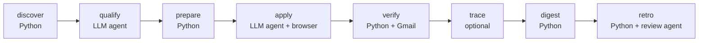

# job-harness

A daily job-application pipeline: discover postings, have an LLM agent qualify them against **your** rules,
tailor a keyword-verified resume per posting, let a browser agent submit the applications, check each one
against the confirmation email, and post a summary. Deterministic Python does everything except two judgement
steps (qualify, apply), so a bad model call cannot corrupt state.



## Read this first: this is one person's Windows tool, published as a starting point

This repo is **not** a generic product you configure with a settings file. It is a working system built on one
Windows 11 machine for one person's job search, then published so that **your own coding agent can adapt it to
you and your machine**. That adaptation is expected: it costs your agent some tokens and a few hours of your
attention, and this README lists every place the author's assumptions are baked in.

Three kinds of author-specific assumptions exist:

1. **Platform: Windows only, as shipped.** It has run daily only on Windows 11 with Python 3.13. Nothing here has been run on macOS or Linux, and `daily.py` will not even start there. See [Platform: Windows-only as shipped](#platform-windows-only-as-shipped).
2. **Personal job goals:** title lists, blocklists, resume variants and routing rules are tuned to the author's target roles. See [What is tuned to the author](#what-is-tuned-to-the-author).
3. **Vendor choices:** discovery uses the treg gateway, receipts are read from Gmail, and the agent runtime is `omp`. See [What is required and what is optional](#what-is-required-and-what-is-optional).

## What is required and what is optional

The human has three decisions to make. Everything else follows from them.

| Decision | Options | Notes |
|---|---|---|
| **1. Which coding-agent CLI runs the daily qualify and apply passes?** | Keep `omp` (as shipped), or port to Claude Code, Codex, or any other headless agent harness | **`omp` is optional.** It is only the author's choice. Porting is small and mechanical; see [Using a different agent harness](#using-a-different-agent-harness-omp-is-optional). |
| **2. Use a CAPTCHA-solving service?** | Yes (RapidAPI "Fast MultiSolver"), or No | **Optional.** With No, every CAPTCHA is escalated to the human instead of solved. See [CAPTCHA solver](#captcha-solver-optional). |
| **3. Use treg for job discovery?** | Yes, or find a replacement | **Not optional in practice.** Discovery has no working substitute in this repo, and finding one is difficult. See [treg: required](#treg-required-and-hard-to-replace). |

| Component | Status | Replaceable? |
|---|---|---|
| treg (BlitzAPI jobs search) | **Required** | Difficult, untested; see below |
| A coding-agent CLI that can run a prompt headlessly, with bash and a browser | **Required (any one)** | Yes: `omp`, Claude Code, Codex, others |
| A model login for that CLI (Claude or ChatGPT/Codex subscription, or API key) | **Required** | Yes, any provider the CLI supports |
| Gmail through `gws` | Required for `verify.py`; otherwise applications stay `unverified` | Yes, rewrite `verify.py`'s mail calls |
| CAPTCHA solver (RapidAPI) | Optional | Remove, or swap the service |
| Private extension stage (`pipeline/trace.py`) | Not shipped | Absent in your clone; the pipeline skips it automatically. See [Extension hook](#extension-hook) |
| Discord digest | Optional | The digest file is always written locally |

## Using a different agent harness (`omp` is optional)

> **🚩 FLAG FOR THE CODING AGENT READING THIS: if the human does not use `omp`, you must rewrite the parts listed in
> this section before anything runs.** The Python is harness-agnostic; the two agent prompts, one function in
> `daily.py`, one config file and two small side-uses are not. Ask the human which CLI they want, then port every row below.
> `omp` is Oh My Pi ([github.com/can1357/oh-my-pi](https://github.com/can1357/oh-my-pi)), an open-source coding-agent harness.
> Nothing about the pipeline's logic requires it. A Claude Code or Codex subscription (or any other harness) can do the same job.

Find every touchpoint yourself with:

```sh
git grep -n -i -E "\bomp\b|\.omp|workpool|browser\.open|tab\.(fill|type|evaluate|press|uploadFile)|mcp\.json|\bscout\b|skill" -- pipeline
```

| # | Where | What it uses from omp | What to port it to |
|---|---|---|---|
| 1 | `pipeline/daily.py`, function `agent()` | Runs `omp -p --no-title --cwd <pipeline dir> --config omp-pipeline.yml <prompt text>`: a one-shot headless run whose output goes to the day's log. Failure is non-fatal (`required=False`) | The replacement CLI's headless invocation (for example `claude -p`, or `codex exec`; check the CLI's own `--help`, the author has not run either). Keep: prompt text as the task, working directory = `pipeline/`, no interactive prompts, no time limit, stdout to the log |
| 2 | `pipeline/omp-pipeline.yml` | Per-run settings overlay: the author's model pins (`default` orchestrator, `task` subagents), a fallback model, retry count and exponential backoff | The replacement CLI's own config: choose models, retries and a fallback there, then delete this file and the `--config` argument |
| 3 | `pipeline/prompts/qualify.md` | `workpool("task")` or `scout`: spawns one sub-agent per candidate in a single call, up to 8 in parallel | Your harness's sub-agent or parallel-task mechanism, or fan out in Python by launching N headless sessions. Parallelism is optional; serial runs are just slower |
| 4 | `pipeline/prompts/apply.md` | `workpool("task", name="apply")` for parallel workers; the omp **browser tool**: `browser.open(name=..., app={...})`, `tab.fill`, `tab.type`, `tab.uploadFile`, `tab.press`, `tab.evaluate("<IIFE>")`; one named tab per application; bash with long timeouts | A browser-automation tool your harness can use (Playwright MCP, a Chrome DevTools MCP, a built-in computer/browser tool). Rewrite the "Method" and "CAPTCHAs" steps in that tool's vocabulary. Keep the rules: one isolated browser context per application, proof only from a confirmation page or email, escalate instead of guessing |
| 5 | `pipeline/prompts/apply.md` and `qualify.md` | omp-specific wording such as "do not use a duplicate-safeguard skill" (an omp/user skill concept) | Delete or reword for your harness |
| 6 | `pipeline/digest.py`, `agent_usage()` and `SESSIONS` | Reads omp's session files under `~/.omp/agent/sessions/...` to print today's tokens and cost in the digest header | Remove the function and its header line, or read your harness's usage logs. The digest works without it |
| 7 | `pipeline/lib/captcha.py`, `MCP_JSON` | Reads the CAPTCHA service key from the `captcha-solver` entry in `~/.omp/agent/mcp.json` | Read it from an environment variable or a key file instead (only matters if you keep the CAPTCHA solver) |
| 8 | Permissions | The author's unattended runs pass no approval flag to omp | Your CLI needs a non-interactive permission mode that lets it run bash and the browser tool without asking; set it in item 1 |

**The contract any replacement must meet.** Python never talks to the agent; it only reads the files the agent leaves.
So a port is correct when:

- **qualify** writes one JSON part file per candidate to `state/verdicts/parts/<date>/` (shape: see "Per candidate" in `prompts/qualify.md`) and the job description text to `state/jd/<key>.txt`. `prepare.py` merges the parts.
- **apply** writes `state/evidence/<key>.json` (and a `.png`) per application, with a status and proof. `verify.py` and `digest.py` read those and the Gmail receipts; the apply agent never writes `state.db` itself.
- Both agents can run bash (for `python lib/captcha.py`, `python lib/notify.py`, `gws`), read local files, and, for apply only, drive a real browser.

After porting, run Gates 6 and 7 below before trusting it. Update the [Repository map](#repository-map) and delete `omp-pipeline.yml` if it no longer applies.

## Two agents, two jobs (do not confuse them)

| Role | What it does | Which tool |
|---|---|---|
| **Setup agent** | Reads this README once, adapts the code and config to the human and their OS, interviews them for their facts. | Any coding agent: Claude Code, Codex, omp, Cursor... |
| **Runtime agent** | Runs unattended every day: executes `pipeline/prompts/qualify.md` and `apply.md` | `omp` as shipped; any headless agent harness after a port |

Using a different agent *for setup only* needs nothing from this section.

## If you are an AI agent: bootstrap protocol

Work through these gates in order. Each has a check. Tell the human what a step costs before you run anything metered.

**Rules you must follow**

1. **Never invent facts about the human.** Name, contact details, work history, dates, metrics, skills, work authorization and salary expectations come from the human, one question at a time. Write only what they confirm. The resume variants, `blitz_answers.md` and `keyword_facts.json` are the only sources the apply agent may type into a form; a wrong line there is submitted to employers under their name.
2. **Tell the human the price before any metered call.** `discover` costs about **$0.0005 per returned posting** (the estimate in `discover.py`). `qualify` and `apply` spend model tokens: roughly one agent session per candidate. Cap them with `limits` in `config.json` before the first live run.
3. **Never commit private files.** `.gitignore` is an allowlist: only code, prompts, `RUNBOOK.md` and this README are tracked. Before every push run `git grep -n -i -E "<their name>|<their email>|<their phone>"` and read the staged diff.
4. **Do not enable the apply stage until the human has reviewed qualify output.** First runs use `--no-apply`. Applications are real, sent in the human's name, and cannot be recalled.
5. **Say what you could not verify.** If you port a code path to the human's OS, say whether you ran it.

**Gate 0. Interview the human (no spend).** First put the [three decisions](#what-is-required-and-what-is-optional) to them
in plain words: which coding-agent CLI will run the daily passes (keep `omp`, or Claude Code, Codex or another; if not `omp`,
you will port it), whether they want a CAPTCHA-solving service (optional), and that treg is required and has no easy
substitute. Then ask for and record: OS, target roles and titles, locations and remote
rules, salary floor, companies or industries to exclude, work authorization, what they refuse to do on a form
(cover letters, exact-salary fields, AI-attestations, account creation), and which accounts they have (Gmail?
Discord? a Claude or ChatGPT subscription?).

**Gate 1. Install prerequisites.**

| Need | Why | Install |
|---|---|---|
| Python 3.9+ (author uses 3.13) | all deterministic stages | python.org, `brew install python`, or your distro. Use `python3` where `python` is absent. |
| `pip install -r requirements.txt` | `fpdf2` renders resume PDFs | in a venv if you like |
| A coding-agent CLI that can run a prompt headlessly, run bash and drive a browser | runtime agent. **Pick one; `omp` is optional** | `omp` as shipped: macOS/Linux `curl -fsSL https://omp.sh/install \| sh`; Windows `irm https://omp.sh/install.ps1 \| iex`; or `bun install -g @oh-my-pi/pi-coding-agent`. For any other CLI, install it and port the [touchpoints](#using-a-different-agent-harness-omp-is-optional) |
| A model login for that CLI | model access | with `omp`: `omp login anthropic` (Claude subscription) or `omp login openai-codex` (ChatGPT/Codex subscription); `omp models` lists what you can use. Other CLIs: their own login |
| Node.js + Google Workspace CLI `gws` (`@googleworkspace/cli`) | verify stage reads Gmail receipts; apply agent reads emailed security codes | `npm i -g @googleworkspace/cli`, then authenticate it to the Gmail account used on applications. **Gmail only**; for other mail providers replace `verify.py` |
| A [treg](https://treg.to/?ref=anthonyxge19-8jtx5) account | **Required.** `discover.py` gets every job posting through treg's BlitzAPI search; see [treg: required](#treg-required-and-hard-to-replace) | sign up, add a little credit (a first discovery run costs cents), then `treg login` so `~/.treg/config.json` exists with `base_url`, `token`, `active_org`. The link is the author's referral link. |

Check: `python --version`, your agent CLI's version command (`omp --version` if using omp), `~/.treg/config.json` exists, and a Gmail call through `gws` that returns JSON.

Subscription logins are meant for interactive use; this pipeline drives them unattended and can burn a lot of
quota. Read your provider's terms on automated use before relying on it, and prefer an API key if in doubt.

**Gate 2. Create the private inputs.** All are untracked. There are no template files; the formats are below.

| Create | Used by | Contents |
|---|---|---|
| `pipeline/config.json` (copy `pipeline/config.example.json`) | every stage | search profile, caps, notification settings; see [Config](#config) |
| `resume_GTM.txt`, `resume_FDE.txt`, `resume_AI.txt`, `resume_TOOLS.txt`, `resume_AI-HEALTH.txt` in the repo root | `prepare` | your resume as plain text, **all five names required** unless you edit the code; see [Resume file contract](#resume-file-contract) |
| `keyword_facts.json` | `prepare` | which skills you may claim; see [keyword_facts.json](#keyword_factsjson) |
| `blitz_answers.md` | `qualify`, `apply` | the only facts the agent may type into forms: legal and preferred name, email, phone, address, links, work authorization, sponsorship need, start date, salary range, current-employer wording, background-check consent, EEO answers (default: decline) |
| `profile/qualify_rules.md` | `qualify` | your binding SKIP / ESCALATE / APPLY rules, location rule, salary rule, exclusions |
| `profile/apply_rules.md` | `apply` | standing answers, consents, whether account creation or third-party sign-in is allowed, what to escalate |
| `resume_routing_context.md` | `qualify` | the author's playbook, which `qualify.md` tells the agent to read ("sections 3, 6, 7, 9"). Either write one with those numbered sections (hard routing, location/comp, skip/escalate, truthfulness) or delete that line from `qualify.md` |
| `routing.json` (optional) | `resume_tailor` | `{"routing": {...}, "title_overrides": {...}}`; may be omitted |

**Gate 3. Adapt the code to the human and their OS.** Walk the [tuned-to-the-author table](#what-is-tuned-to-the-author)
and the [Windows-only list](#platform-windows-only-as-shipped), confirm each item with the human, and edit. Mandatory for everyone:
the absolute paths in `config.json` and the two prompts, the agent harness port if not `omp` (or the model pins in `omp-pipeline.yml` if it is), `query.titles`/`searches`,
the regexes in `discover.py`, `VARIANTS`/`decide_variant()`, the Gmail check in `resume_tailor.py`, and the escalation list
in `prompts/apply.md`. Everyone not on Windows also ports the lock, the scheduler and the paths.

**Gate 4. Offline checks (free).**

```sh
python pipeline/discover.py --dry-run          # prints the search payloads, calls nothing
python pipeline/ledger.py list --days 7        # state.db opens and the schema creates
python pipeline/watchdog.py                    # reports "no heartbeat file" before the first run: expected
```

**Gate 5. Metered but harmless: discovery only.** `python pipeline/daily.py --discover-only` calls the job gateway
(about $0.0005 per returned posting), uses no LLM and no browser. Read `pipeline/state/candidates-latest.json` and
`pipeline/state/dropped-<date>.json` with the human. Tune the blocklists until both look right.

**Gate 6. Qualify and tailor, no submissions.** `python pipeline/daily.py --no-apply` spends model tokens on
`qualify`, then renders resumes. Review `state/verdicts/<date>.json`, the PDFs in `resumes/`, and the digest in
`state/digest-<date>.md` with the human. Every verdict reason should be one the human agrees with.

**Gate 7. Supervised apply.** Set `limits.max_applications_per_day` to 1 to 3 and run `python pipeline/daily.py`.
Watch `state/evidence/<key>.json` and the confirmation emails. Count an application as submitted only when `verify`
shows a receipt. Raise the cap gradually.

**Gate 8. Schedule.** See [Scheduling](#scheduling). The machine must be awake and logged in at run time.

## Quick start for a human (no agent)

Realistically, point your coding agent at this repo and say "follow the README". Doing it by hand means every item
in Gates 1 to 3, including editing code, so the agent route is the supported one.

[`pipeline/RUNBOOK.md`](pipeline/RUNBOOK.md) documents stages, caps, guards and the state schema in depth, but it is
the author's Windows ops log (`C:/` paths, Task Scheduler, dated incidents): **where it disagrees with this README, this README wins.**

## How the pipeline works

| Stage | Run by | What it does | Output |
|---|---|---|---|
| discover | `discover.py` | job search through the gateway; drops anything already decided, agencies and blocked titles | `state/candidates-latest.json`, `state/dropped-<date>.json` |
| qualify | `omp -p` with `prompts/qualify.md` | reads each JD, finds the employer's own application URL, applies your rules, saves the JD text | `state/verdicts/parts/<date>/*.json`, merged to `verdicts/<date>.json` |
| prepare | `prepare.py` + `resume_tailor.py` | routes each APPLY verdict to a resume variant, adds JD keywords you may truthfully claim, renders a PDF | `resumes/`, `state/apply-queue.json` |
| apply | `omp -p` with `prompts/apply.md` | fills and submits forms in a browser, writes proof or an escalation | `state/evidence/<key>.{json,png}` |
| verify | `verify.py` | matches Gmail receipts to applications; anything unproven is downgraded to `unverified` | `state.db` |
| extension | `trace.py` (private, not published) | optional post-verify stage; skipped when the file is absent | `state.db` |
| digest | `digest.py` | one markdown summary, optionally posted to Discord | `state/digest-<date>.md` |
| retro | `retro.py` (after digest, in-process) | telemetry, one review agent pass, gated and revertible self-healing changes | `state/retro-<date>.md`, `state.db` |
| pow generate | `pow.py daily` (after verify, before the extension; off by default) | one grounded proof-of-work artifact per **confirmed** application, validated by Python | `state/pow/artifacts/*.json`, `pow_artifacts` |
| pow reconcile | `pow.py reconcile --readonly` (after the extension; off by default) | confirms published pages, lists artifacts whose draft can still take the line | stdout only |

`state/state.db` (SQLite) is the source of truth. `python pipeline/ledger.py check|list|add|outreach|lead|resume-change`
reads and appends to it, including applications you made by hand. A day with zero candidates still runs verify, trace and
digest. A failed stage stops the run but still sends a digest. A lock file prevents overlapping runs. There are **no agent
timeouts**: a hung agent blocks that day's run until you kill it.

## Post-run retro (self-healing)

After digest, `daily.py` runs `retro.py --in-process` (non-fatal, `required=False`). Python computes the day's telemetry (funnel, per-stage tokens and cost, skip reasons, apply outcomes, stage durations) into `state/retro-<date>-brief.md`. One `omp -p` pass with `prompts/retro.md` reads it and proposes changes. The agent edits nothing itself: `retro.py` owns every mutation.

- **Allowlist.** Changes may touch only files in `RETRO_WRITABLE`. `RETRO_FORBIDDEN` blocks `profile/`, `config.json`, `state/`, `trace.py`, every `pow*` file (artifact generator, prompts and telemetry), resume files and answer files. Code and prompt changes are unified diffs, applied with `difflib` and then `py_compile`-checked (the file and every module importing it) or prompt-section-checked.
- **Data-only changes** (blocklist, discover regexes, ATS hints) are merged by Python into `state/blocklist.json`, `state/discover-overrides.json` and `state/ats-hints.json`. `discover.py` and `prompts/apply.md` read them; absent files are a no-op.
- **Grading and revert.** Each change keeps a `.retro-bak` copy and is graded over the next 2 runs. A better KPI marks it verified; a KPI worse by 5% reverts it (backup, else `git checkout`, else drop the data entry). History is in the `retro_runs` and `retro_actions` tables of `state.db`.
- **Retro cost is excluded from the pipeline KPI** (reported as `kpi.retro_cost_usd`), so the reviewer cannot inflate its own metric.
- **Config.** The `retro` block in `config.example.json` (`enabled`, `agent_timeout_seconds`, `grace_runs`, ...) and an optional `notify.retro_webhook_file` for its own Discord digest.
- **CLI.** `python pipeline/retro.py [--status|--dry-run|--no-agent|--backfill N|--digest|--day D]`.
- **Porting.** It is an omp touchpoint like the other agent calls: if you replace `omp`, replace the agent call in `retro.py` too.

## Proof-of-work artifacts (optional, off by default)

After `verify`, `daily.py` can generate **one grounded artifact per confirmed application**: a short public page (a
live account list with public buying-trigger evidence, a runnable connector repro, or a measured eval) that shows how
the candidate thinks about that
employer's problem. It is published by the [TraceHire](https://github.com/tonyGePT/tracehire) host and one line about
it is appended to the existing outreach Gmail draft. **Nothing is sent by this pipeline.**

```sh
python pipeline/pow.py signals --titles "driver recruiter,fleet safety manager" --days 21 --countries US
python pipeline/pow.py signals --titles "driver recruiter" --icp-keywords "trucking,freight" --sizes "51-200,201-500"
python pipeline/pow.py signals --emit-sources       # free: the stored postings as sources entries
python pipeline/pow.py signals --dry-run …          # free: print the request, call nothing
python pipeline/pow.py generate --url <posting url>                 # one omp pass, metered
python pipeline/pow.py generate --url <url> --candidate cand.json   # validate/store a candidate you wrote
python pipeline/pow.py validate cand.json --url U --company C --role R --recipe R
python pipeline/pow.py run <artifact_id>            # ai_eval: built-in evaluator
python pipeline/pow.py run <artifact_id> --execute  # FDE: runs the artifact's own code (opt-in)
python pipeline/pow.py publish <artifact_id>        # requires pow.publish_enabled
python pipeline/pow.py attach <artifact_id> --run <run id>   # requires pow.attach_enabled
python pipeline/pow.py revoke <artifact_id>
python pipeline/pow.py status [--url U] [--json]
python pipeline/pow.py reconcile [--readonly] [--dry-run]
python pipeline/pow.py daily [--dry-run]            # what daily.py calls
python pipeline/pow.py smoke                        # offline end-to-end: temp DB + local stub host
```

- **The `gtm_signal` artifact is a live account list, not a summary of the employer's website.** It is an
  `accounts.csv` of real companies (account, buying trigger, posting URL, open-role count, posted date, detected ATS)
  plus 3-5 findings read off those rows. Its rows may only come from `pow.py signals`, which is the **only** place
  `pow.py` calls a provider: **`blitzapi.jobs.search`** (BlitzAPI `POST /v2/jobs/search` through treg's proxy,
  `treg catalog get blitzapi.jobs.search`, verified 2026-10-16) at **$0.000495 per returned job row** (1 credit; an
  empty page is free, `max_results` 1-50, cursor paginated). It authenticates with the same `~/.treg/config.json`
  token `discover.py` uses and never logs it. Python enforces the budget: `pow.treg_budget_usd`
  (default `$0.75`) per artifact, a per-call `X-Treg-Route-Max-Cost` header carrying what is left, an
  `Idempotency-Key` per call, and a hard stop with a clear message when the budget is spent. There is
  no call cap: a fetch run keeps paginating until the money or the cursor runs out. One call of 50 rows
  at `max_results` 50 costs about `$0.025`. The spend is recorded on the artifact's `generated` event
  as `details.cost_usd`/`details.treg_calls`, which is what `pow_metrics.py report` sums.
- **Python writes the table; the model only chooses.** A model-written CSV fails for reasons that have
  nothing to do with the finding (an unquoted comma in a company name, a hand-typed date, a `detail`
  that contradicts the store, a retyped excerpt), so the candidate's `accounts.csv` is parsed leniently
  for its **posting URLs only** and the table is rebuilt from `state/pow/signals/<token>.jsonl`: account
  and trigger from the fetched posting, `evidence` the URL, `detail` the computed open-role count,
  `posted` the fetched date, `ats` what the URL reveals, written by the `csv` module so every cell is
  quoted. Row order is the candidate's (strongest signal first), one row per company, and the
  `acct-<n>` sources are regenerated from the store — an account source no kept row refers to is pruned,
  so a finding that cites one fails as an unknown source. A URL that is not in the store is refused.
- **Depth, order and the hook are recipe rules, not model taste.** The prompt requires at least three
  differently-aimed searches (title variants, a 7-day and a 21-day window, ICP filters) until the pool is
  large enough to be selective, aiming at 12-20 kept accounts with 8 as the floor; `pow.py signals` prints
  the pool (postings and distinct companies) and the spend after every call, so the agent can see the store
  growing. Row order is the candidate's and Python keeps it: freshest first, then recognizable/large
  operators, then multi-posting companies. `title`, `thesis` and `email_line` may name kept accounts
  (case-insensitive); Python refuses a company-shaped name (`Logistics`, `Freight`, `Inc.`, …) that is not
  the employer, an integration partner or a kept row, and refuses any fetched company the pack dropped.
  Recency is a computed placeholder (`{freshest_days}`, `{n_recent_3d}`), a count that resolves to 0 or 1 in
  the headline is refused ("1 accounts" is not a hook), a finding may not be a statement of absence ("none of
  the URLs reveals…" belongs in `limitations`), and `{n_ats_match}` only exists from two matching rows up —
  the postings are mostly LinkedIn URLs, so ATS is not the hook.
- **Grounding is re-derived, not trusted.** Every fetch lands in `state/pow/signals/<token>.jsonl`; validation requires
  each `accounts.csv` row's evidence URL to exist there, the account to be that posting's company, the trigger to use
  the posting's own title words, the posted date to be the fetched date inside the window, the `ats` column to be what
  the URL implies, and each `acct-<n>` source to quote the stored excerpt exactly. Since Python rebuilds all of that
  from the store, those checks can only fail on a bug here, not on a model's typing; the check that still bites is the
  URL, and an URL the fetch never returned is refused. At least 8 distinct accounts are required; below that the
  candidate is recorded as an **abstention** with the count, and the fetch cost is recorded anyway. A `gtm_signal`
  candidate without a signal store is refused outright. For a candidate you wrote by hand, `--signals FILE` (or
  `JOBHUNT_POW_SIGNALS`) points validation at an existing store, which is how the offline smoke, a salvage run and any
  re-validation work.
- **Every pack carries its own method.** One finding must be the method: the trigger, the funnel
  counts and the keywords that ran — `{n_fetched}` postings retrieved, `{n_companies}` distinct
  companies, `{n_accounts}` kept, `{window_days}`-day window, and `{titles}` rendered from the fetch
  log (never from the model). Python rejects a `gtm_signal` candidate with no such finding, so the
  page reads as a rule the reader could re-run instead of a list that appeared.

- **The model writes a candidate; Python decides.** The envelope (`posting_url`, `company`, `role`, `recipe`,
  `artifact_id`, `generated_at`) is filled by `pow.py`, so an artifact cannot be mislabelled. A candidate that is not
  supported by its sources is rejected with reasons and stored as `rejected` (never published). Recipes that cannot be
  supported honestly **abstain** with a reason instead of padding a fake artifact.
- **Validation is deterministic** (`validate_artifact`): required keys and caps, public `http(s)` sources only,
  recomputed SHA-256 of every excerpt, every finding and result evidence id must resolve, `passed` results are only
  allowed when `pow.py` executed them, and per-recipe minimums (GTM: `accounts.csv` + grounded rows + 3-5 findings +
  one source per row; FDE: docs evidence + a runnable file + explicit execution status; AI eval: an executed `eval:`
  result). Headline numbers are **placeholders** (`{n_accounts}`, `{n_multi}`, `{window_days}`,
  `{freshest_days}`, `{n_recent_3d}`, plus `{n_fetched}`, `{n_companies}`, `{titles}` and `{n_ats_match}`
  where the recipe defines them): Python substitutes the counts it computed from the grounded rows, a bare
  two-or-more-digit number in `title`, `thesis`, `email_line` or a finding claim is rejected, and so is a
  placeholder that resolves to 0 or 1 in `title`, `thesis` or `email_line`. A 12-word run copied from the job
  description or the resume is rejected, as are email addresses, phone numbers, credentials and local paths
  (`scan_publish_safety`; the host re-checks and 422s on the same classes).
- **Nothing model-written runs automatically.** `ai_eval` artifacts are executed by a built-in deterministic evaluator
  (`pow.py __eval`, our code, isolated child process, bounded timeout) over a declarative `.json` spec: no model, no
  network, no `pip`. An artifact's own code (`fde_integration`) runs only after an operator passes `--execute`, in a
  scratch dir with a minimal environment and a timeout; otherwise results stay `not_run`.
- **Publishing and attaching are separate, explicit, and config-gated** (`pow.publish_enabled`, `pow.attach_enabled`,
  both default `false`). The daily stage generates only; `reconcile` runs read-only there. The host's content
  identity is the canonical UTF-8 sorted-key JSON of the whole artifact, `artifact_id` included, and that is what
  `pow.py` sends as `dedupe_key`; an identical re-post dedupes onto the existing page, a regenerated artifact (new id)
  is a new page. A host-returned sha256 that is missing or differs from that
  `dedupe_key` makes the publish fail nonzero: the row keeps its previous status (so it stays unattachable), the remote
  page is reported as an uncertain external effect and is never deleted automatically. Attach never edits anything but the artifact
  line, and the host refuses sent drafts, unrelated postings and duplicate drafts.
- **Caps and bounds are dollar budgets.** `pow.enabled` + `pow.daily` gate the stage (both default `false`, so no
  implicit omp spend); `pow.max_per_day` caps generations per day; `pow.agent_budget_usd` (default `2.00`) caps one omp
  pass through `omp --max-cost`, where print mode exits 3 at the cap and `pow.py` then validates whatever candidate the
  agent had written; `pow.treg_budget_usd` (default `0.75`) caps the signal fetch, which has no call cap at all;
  `pow.window_days` (default 7) limits which confirmed applications are eligible; `pow.signal_window_days` (default 30)
  is the "posted within" window for a `gtm_signal` fetch and its validation; a non-blocking `state/pow/.lock` prevents
  two agent passes at once. Two timeouts remain, and neither is a job limit: `pow.exec_timeout_seconds` bounds one
  evaluator/harness child process, which costs no money and would otherwise hold the pipeline `.lock` from a runaway
  loop, and the HTTP socket timeout on treg/host requests turns a dead connection into an error instead of a hang.
- **State.** `state/pow/artifacts/<id>.json` (what publish sends), plus `state/pow/candidates/`, `state/pow/rejected/`,
  `state/pow/tmp/`, and `state/pow/signals/<token>.jsonl` + `<token>.meta.json` (every fetched posting, and the
  per-call fetch ledger that carries the spend). `state/pow/task.json` is the current pass' brief: recipe, target,
  `signals_token`, `signals_path`, the treg and agent budgets, and `candidate_path`. Rows live in the additive `pow_artifacts` and
  `pow_events` tables of `state.db`; `pow_events` is immutable attribution evidence, and `retro.py` may never edit
  `pow*` files (`RETRO_FORBIDDEN`).

### Attribution (pow_metrics.py)

Reads `state/state.db` only; never contacts a provider, never reads Gmail, never sends mail.

```sh
python pipeline/pow_metrics.py record --kind sent --artifact-id <id> --sent-artifact-url <artifact url> --evidence-ref gmail:<message id>
python pipeline/pow_metrics.py report [--days 30] [--horizon-days 14] [--cohort C] [--json] [--details]
python pipeline/pow_metrics.py status [--limit 50]
python pipeline/pow_metrics.py pending [--days 3650]
```

`record` is the only writer. The five outcome kinds (`sent`, `reply`, `positive_reply`, `interview`, `offer`) require
an external evidence reference (message id, receipt subject, sheet row); a Gmail draft id and the artifact's own
published URL are rejected as evidence. A `sent` credits an artifact only when `--sent-artifact-url` exactly matches
that artifact's stored `published_url` (trailing slash aside) **and** the operator attests that the message actually
sent carried that link, together with the real sent-message evidence; a `published` or `attached` event is not proof of
the message's content. Every other send is stored as an unverified control send (`artifact_id` NULL,
`details.pow_unverified` + `unverified_reason`) and never inflates the artifact's numbers. `--cohort` is accepted only
on `generated`/`published`/`attached`; outcome events inherit it and cannot relabel it. `pow.py` uses the ISO week of
creation (`2026-W45`) as that batch label, so cohort and recipe stay separate dimensions. Exact attribution uses `pow_store.url_key`, preserving identifying query parameters while dropping `utm_*`, fragments and trailing slashes; `details.posting_url` retains the source URL for audit. Query-distinct postings are not merged. There is no open/read tracking or Gmail reconciliation. `pending` prints the real publish command and a human-operated sent record command.
Outcomes are measured only from a sent event's timestamp through the configured horizon. Late outcomes are shown separately, not included in the rate or latency; rates use matured sends and separately show censored, pending and unsent counts. Reports are descriptive, not causal.

`pow.py smoke` is the offline proof of all of this: a temp state dir, a local stub of the four host routes, a fixture
`treg` response ingested by `signals`, the built-in evaluator, and the privacy/execution/grounding refusals — no agent
pass, no paid call, no external network. It asserts the positive path (grounded rows pass, placeholders resolve to the
computed counts, a hand-crafted `accounts.csv` is rebuilt cell by cell with proper quoting, a title names kept accounts
and states the computed recency, the candidate's row order is preserved) and the negative ones (a row absent from the
fetch, an invented headline number, a count that resolves to 0 or 1 in the headline, a finding that states an absence, a
company-shaped name that is not a kept row, a fetched company the pack dropped, `{n_ats_match}` with fewer than two
matches, fewer than 8 accounts → abstention, a spend budget that stops the fetch, a finding that cites a pruned account
source). It also asserts that one omp pass is built with `--max-cost <pow.agent_budget_usd>` and no timeout, and that
`signals` prints the pool and the spend after every call, against a mocked subprocess and fixture responses.

## Config

`pipeline/config.json` (copy of `config.example.json`). **Every path in it must be absolute** and `harness`,
`state_dir`, `notify.email` and `gws` are required; nothing is resolved relative to the repo.

| Key | Meaning |
|---|---|
| `harness` | absolute path of this repo's root (where `resume_*.txt` live) |
| `state_dir` | absolute path of `pipeline/state` |
| `resume_prefix` | PDF filename prefix, e.g. `Jane_Doe_Resume` gives `Jane_Doe_Resume_<key>.pdf` |
| `query.titles`, `query.searches` | title keywords and the searches to run (remote, plus local hybrid/on-site by city) |
| `query.exclude_hq_cities`, `date_posted_days`, `is_agency`, `page_size`, `max_pages_per_search` | filters and paging |
| `limits.max_candidates`, `max_applications_per_day`, `max_captcha_solves_per_day` | hard caps. `max_applications_per_day` counts attempts queued, not confirmed submissions. The default 50 is high for a first run |
| `notify.email` | **your** mailbox address; mail from yourself is excluded when matching receipts |
| `notify.discord_*` | optional; without them the digest is only the local file |
| `gws.node`, `gws.cli` | absolute path to `node` and to `@googleworkspace/cli/run-gws.js`. The author launches gws as `node run-gws.js` because the Windows `.cmd` shim mangles JSON arguments. On macOS/Linux change `verify.py` to call `gws` directly |
| `pow.enabled`, `pow.daily` | **both default `false`.** The after-verify generation stage runs only when both are true, so a fresh config never spends an agent pass or creates a public page |
| `pow.publish_enabled`, `pow.attach_enabled` | **default `false`.** `pow.py publish` / `attach` refuse without them, even when an explicit artifact id is given; the scheduled run never calls either |
| `pow.max_per_day`, `pow.agent_budget_usd`, `pow.exec_timeout_seconds` | generation cap per local day (default 1), dollar cap on one omp pass (default 2.00, passed as `omp --max-cost`; exit 3 means the cap was reached and the candidate on disk is validated anyway), hard bound on one evaluator/harness run (60 s — a local child process costs nothing and a runaway loop would hold the pipeline `.lock`) |
| `pow.window_days`, `pow.signal_window_days` | how recent a confirmed application must be to get an artifact (default 7), and the "posted within N days" window for a `gtm_signal` posting fetch and its validation (default 30) |
| `pow.treg_budget_usd` | the only bound on the `gtm_signal` signal fetch per artifact: dollars (default 0.75). There is no call cap — a run keeps paginating until the money or the cursor runs out. Python stops and says so when the budget is spent, and records the real spend on the artifact's `generated` event |

Set `JOBHUNT_STATE=<dir>` to run any stage against a copy of `state/`.

## Resume file contract

Five files in the repo root, named exactly `resume_GTM.txt`, `resume_FDE.txt`, `resume_AI.txt`, `resume_TOOLS.txt`,
`resume_AI-HEALTH.txt` (the names are hard-coded in `VARIANTS` in `resume_tailor.py`). `prepare.py` picks one with
`decide_variant()`, which routes on title and JD keywords to those five names and crashes if the chosen file is missing.
**Simplest adaptation:** edit `VARIANTS` and `decide_variant()` down to the variants you really have, even one. Plain
text, UTF-8:

```
Line 1: your name
Line 2: headline (replaced with the job's own title in each tailored copy)
Line 3: contact line; MUST contain the literal text "gmail.com" (hard-coded sanity check in tailor(); change it to "@")
Then sections whose headings are exactly: SUMMARY, EXPERIENCE, PROJECTS, EDUCATION, SKILLS
"* " starts a bullet. "Employer  |  Role  |  dates" lines render as bold entry headers.
"Label: a, b, c" lines (in SKILLS) render with a bold label.
```

At least 5 lines are required. The PDF renderer is hard-coded to those five headings and a built-in Latin-1 font, so
characters outside Latin-1 become `?`. Edit `render_pdf()` for another layout or alphabet.

**Know what the keyword engine does.** For each posting it finds the keywords the JD names and guarantees 100% of them
appear on the generated resume. Skills in `keyword_facts.json` with tier A and a written `basis` go on an `Also:` line.
Tier B/C skills and every *unmapped* JD term go on an `Also familiar with:` line **even if you have no experience with
them**. That was the author's deliberate keyword-match strategy. If you do not want unverified terms on your resume,
change the `familiar_missing` handling in `tailor()`; decide this with the human at Gate 3 and never leave it as an
unexamined default.

### keyword_facts.json

```json
{
  "entries": {
    "python":     {"aliases": ["Python", "Python 3"],   "tier": "A", "basis": "Wrote production services in Python for 5 years."},
    "kubernetes": {"aliases": ["Kubernetes", "K8s"],    "tier": "B", "basis": "Deployed to a team-run cluster; did not administer it."},
    "clearance":  {"aliases": ["security clearance"],   "tier": "C", "basis": null}
  }
}
```

Tier A = real hands-on experience, claimable once `basis` says what you did. Tier B = adjacent exposure. Tier C = never
claim. An entry in tier A or B with `basis: null` is BLOCKED and the engine will not claim it. The first alias is the
spelling written onto the resume. `python keyword_coverage.py --jd FILE.txt --variant resume_X.txt` reports coverage for one JD.

## Platform: Windows-only as shipped

Verified: Windows 11, Python 3.13, daily since 2026-10-29. **Not run on macOS or Linux, and known not to start
there.** Adapting it is the setup agent's job. Everything Windows-specific:

| Where | Windows assumption | What a port does |
|---|---|---|
| `pipeline/daily.py` line `import msvcrt` and the `msvcrt.locking(...)` call | single-run lock; `msvcrt` does not exist on macOS/Linux, so the orchestrator fails on import | use `fcntl.flock(f, LOCK_EX \| LOCK_NB)` on POSIX |
| `pipeline/daily.bat`, `watchdog.bat`, `daily-hidden.vbs`, `watchdog-hidden.vbs`, `register-tasks.bat` | hard-coded `C:\Python313\python.exe` and `C:\tmp\jobharness\pipeline\...`; Task Scheduler (`schtasks`) with a `wscript` wrapper to avoid a console flash | write a cron entry or a launchd LaunchAgent (see below); on Windows, either clone to `C:\tmp\jobharness` with Python at `C:\Python313`, or edit these five files |
| `pipeline/watchdog.py` `toast()` | PowerShell balloon notification; failures are swallowed, so it is a silent no-op elsewhere | `osascript` (macOS) or `notify-send` (Linux) |
| `pipeline/prompts/apply.md`, `qualify.md` | literal `C:/tmp/jobharness/...` paths (answers file, rules files, JD folder) and `C:/Python313/python.exe` for `captcha.py` and `notify.py` | replace with your absolute paths |
| `pipeline/config.json` | absolute `C:/` paths; `gws` as `node` + `run-gws.js` | your absolute paths |
| `pipeline/lib/captcha.py`, `digest.py` | read `~/.omp/agent/mcp.json` and `~/.omp/agent/sessions/--<repo path with : / \ replaced by ->--/`; the session directory naming on other OSes is unconfirmed, and the digest's cost line is omitted if the folder is not found | check how omp names the session folder on your OS |
| `pipeline/omp-pipeline.yml` | not OS-specific but personal: the author's model pins and fallback (`muskapi2/gpt-6.1-terra`, `openrouter/deepseek/deepseek-v4.1-flash`, `anthropic/claude-sonnet-5-5`) | replace with ids from `omp models` for your login, or delete the `modelRoles` block to use omp's default |

Things to know on every OS:

- `daily.py` runs `omp` by bare name, so it must be on `PATH` for the scheduler's environment. cron and launchd start with a minimal `PATH`; set it explicitly in the job.
- A sleeping laptop skips a run. `watchdog.py` leaves `state/ALERT` when no heartbeat has arrived for 26 h.

### Scheduling

Windows (as shipped): after the paths in the five launcher files are right, `register-tasks.bat` registers `JobHuntDaily` (08:00 daily)
and `JobHuntWatchdog` (every 120 minutes); `schtasks /Query /TN JobHuntDaily /FO LIST /V` shows status.
macOS/Linux: run `python3 pipeline/daily.py` once a day and
`python3 pipeline/watchdog.py --quiet` every couple of hours from cron or launchd, with `cwd` set to `pipeline/` and a `PATH` that includes `omp`,
`node` and `gws`. These are not shipped and have never been run.

`register-tasks.bat` also registers `JobHuntRetro` (daily 12:00), a backstop for a run that died before reaching digest. It takes the same lock non-blocking, exits if `daily.py` is still running, and exits unless `state/digest-<today>.md` exists. Normally `daily.py` runs retro in-process right after digest, so the timer does nothing.

## What is tuned to the author

Change each of these for your goals. None of it is a bug; it is the author's preference baked into code.

| Where | What is baked in | Change it to |
|---|---|---|
| `pipeline/config.example.json` `query.*` | a short generic list; the author runs 47 titles across GTM/solutions/automation/operations roles and a local-city search | your own titles, work arrangements and cities |
| `pipeline/discover.py` `TITLE_BLOCK`, `MANAGER_BLOCK`, `MANAGER_ALLOW` | drops titles with words like designer, director, SDR, intern, QA, and "manager" unless it is an ops/automation family | titles you do or do not want |
| `pipeline/discover.py` `AGENCY_BLOCK`, optional `state/blocklist.json` | staffing and consulting firm names | your own exclusions |
| `pipeline/prepare.py` `decide_variant()` | maps title and JD keywords onto exactly five names: `GTM`, `FDE`, `AI`, `TOOLS`, `AI-HEALTH` (including a healthcare-OCR heuristic) | your variants and rules |
| `resume_tailor.py` | `VARIANTS`, the `gmail.com` header check, `NON_KEYWORDS` boilerplate list, optional `routing.json`, fixed PDF layout and headings; `JD_FILES` and `main()` belong to the author's old batch workflow and are not used by the pipeline | edit or trim |
| `pipeline/prompts/qualify.md`, `apply.md` | the ATS host list, the escalation list (exact-salary demand, legal/export wording, mandatory cover letter, AI-attestation, anonymous staffing reposts), the "only a confirmation page or email counts as proof" rule, the evidence JSON shape, and omp-specific tool names | your policy. Put personal rules in `profile/*.md`, not in the prompts |
| `pipeline/verify.py` `ATS_DOMAINS` and the Gmail query | recognised ATS senders and receipt-subject phrases | add your ATS domains; replace the Gmail calls entirely for another mail provider |
| `pipeline/lib/state.py` schema | tables `history`, `outreach`, `resume_changes`, `log_notes`, `leads` exist because the author migrated a markdown log into them; harmless if unused | drop what you do not need |
| `pipeline/lib/notify.py` | the Discord User-Agent string names the author's repository | your repo URL (Discord rejects the default urllib agent) |
| `pipeline/trace.py` (not shipped) | the extension hook: `daily.py` runs it only if the file exists | nothing; see [Extension hook](#extension-hook) |
| `pipeline/lib/captcha.py` | calls the RapidAPI "Fast MultiSolver" service, reading its key from the `captcha-solver` entry in `~/.omp/agent/mcp.json` | optional; remove or replace. Solving CAPTCHAs may violate some sites' terms, your call |

## treg: required, and hard to replace

**Decision for the human: the pipeline needs treg. There is no substitute in this repo, and the author expects finding one to be difficult.**
Get an account through the author's referral link: <https://treg.to/?ref=anthonyxge19-8jtx5>.

**What it is for.** treg is a metered gateway to many data APIs. This pipeline uses exactly one call: BlitzAPI's jobs search,
`POST <base_url>/call/blitzapi.jobs.search`, sent by `call_treg()` in `pipeline/discover.py` with the credentials `treg login` writes to
`~/.treg/config.json` (`base_url`, `token`, `active_org`). It is the **only source of postings** for the whole pipeline: `discover`
turns the response into `state/candidates-latest.json`, and qualify, prepare, apply, verify and digest all start from that file.
With no discovery there is nothing to qualify.

**Why it is not optional.** The search is structured, not a scraper. `build_payloads()` in `discover.py` relies on all of these being
filterable server-side, and the dedupe, agency and location rules assume them:

- job title keywords, country, and city lists;
- `work_arrangement` (Remote Solely / Remote OK / Hybrid / On-site);
- `date_posted.last_days`, which the author runs as a rolling 3-day window because postings reach the index a day or more late;
- company flags: `is_agency`, and company headquarters city (used for exclusions);
- cursor paging (`max_results`, `cursor`, `total_results`), and a per-call cost header (`x-treg-cost-micro`) that the run logs.

**Why a replacement will be difficult.** You need a source of fresh, de-duplicated job postings that carries employer, work
arrangement, posting date and an agency flag, that you may legally query unattended every day, and that returns the employer's own
application link or enough to find it. Raw job-board scraping tends to violate the boards' terms and gets blocked; most free feeds
lack structured remote/hybrid and agency fields. The author has **not** tried to replace it, so this is an assessment, not a
tested result.

**If you must replace it anyway.** Write a function that produces the same candidate records and swap it in for `call_treg()` /
`fetch_all()`: `{"candidates": [{url, company, title, posted, location, ai_summary}, ...]}` in `state/candidates-latest.json`, while
keeping the rest of `discover.py` (title and agency filters, `dropped-<date>.json`, dedupe against `state.db`). For a manual stopgap,
`python pipeline/discover.py --results FILE` runs the filters and dedupe over a saved response instead of calling treg.

## CAPTCHA solver (optional)

**Decision for the human: use it or not. The pipeline works without it.** It is the RapidAPI "Fast MultiSolver" service
(`fast-multisolver.p.rapidapi.com`), called by `pipeline/lib/captcha.py` for token CAPTCHAs only: reCAPTCHA v2 and v3, hCaptcha,
Cloudflare Turnstile and CaptchaFox. Image and slider challenges are never solved. It needs a RapidAPI subscription to that API, and
`captcha.py` reads the key from the `captcha-solver` entry in `~/.omp/agent/mcp.json` (see [touchpoint 7](#using-a-different-agent-harness-omp-is-optional) to change that).

- **To use it:** subscribe on RapidAPI, put the key where `captcha.py` reads it, and keep `limits.max_captcha_solves_per_day`
  (default 10) as your spending cap. As shipped, token injection into a live ATS form is **unproven end to end**.
- **To skip it (recommended for a first run):** delete `pipeline/lib/captcha.py`, remove `max_captcha_solves_per_day` from `config.json`,
  and in `pipeline/prompts/apply.md` replace the whole "CAPTCHAs" section with one rule: *any CAPTCHA is an escalation*; write the evidence JSON
  with status `escalated` and a `blocking_question` starting "CAPTCHA", exactly as the prompt already does for unsolvable ones.
  The human then finishes those applications by hand from the digest.
- Automated CAPTCHA solving may violate some sites' terms of use. That is the human's call, not the agent's.

## Other services

| Service | Used for | Required? | Cost | How to replace |
|---|---|---|---|---|
| A model login for your agent CLI (Claude or ChatGPT/Codex subscription, or API key) | qualify and apply | yes | your plan quota or token spend | the CLI's own login (`omp login <provider>` for omp) |
| Gmail through `gws` | verify receipts, emailed security codes during apply | needed for `verify.py`; otherwise every application stays `unverified` | free | replace `verify.py`'s mail functions |
| Discord bot or webhook | digest and unsolved-CAPTCHA alerts | no | free | `notify.py` reports "not configured" and the run continues |

## Known gaps and gotchas

- **Applications are submitted automatically in your name.** Review early output hard; the human is responsible for what is sent.
- Token CAPTCHAs can be solved by `lib/captcha.py`, but injecting a solved token into a live ATS form has **not** been proven end to end. Image and slider challenges always escalate.
- Workday-style flows that force account creation record the generated password **in plaintext** in `state/evidence/<key>.json`. Keep `state/` private and encrypted at rest, or forbid account creation in `profile/apply_rules.md`.
- `ledger.py check` treats today's own `APPLY` verdict rows as plausible duplicates. `apply.md` tells the apply agent not to run it on a prepared queue for that reason; do not remove that instruction.
- The qualify agent writes per-candidate verdict part files and Python merges them. If you change the qualify prompt, keep that contract or the merge finds nothing.
- With no timeouts, a stuck agent process (`omp` or your replacement) blocks the next day's run (the lock stays held). Kill the stuck process; `watchdog.py` tells you.
- Model providers sometimes congest; as shipped `omp-pipeline.yml` configures retries with exponential backoff and an orchestrator fallback model. A different harness needs the equivalent in its own config.
- Never treat the agent's claim of success as proof. `verify.py` reading a confirmation email is the ground truth, and the digest separates `APPLIED` from `UNVERIFIED`.
- **PoW artifacts need the private host.** Generation, validation and the built-in evaluator work offline, but `publish`/`attach`/`revoke`/`reconcile` need the TraceHire worker (`tracehire.base`) and its API key; the include `pow.py smoke` stub is the only offline publish path.
- **`pow.py run --execute` runs model-written code.** It is opt-in per artifact, in a scratch dir with a minimal environment and a timeout, but there is no network isolation on the host: run only artifacts you have read.
- **Attach never creates mail.** It appends one line to an existing, unsent Gmail draft from a run on the same posting; with no draft (or a sent one) it refuses and says why.
- **Two URL identities on purpose.** `pow_artifacts.url_key` uses the host's posting identity (`lib/pow_store.url_key`): fragment, trailing slashes and `utm_*` params dropped, every other query parameter kept in order, host lowercased, path case kept — scheme-less locally, while the host's returned `url_key` also keeps `https://`, so compare local keys only with local keys. The stored `posting_url` is the exact URL — query tokens included — because the host matches attach on it. Do not "clean" the exact URL, and do not swap in the pipeline's coarser `S.norm_url` for PoW identity.
- `state/` contains job descriptions, evidence screenshots, receipts and possibly passwords. The allowlist `.gitignore` keeps it out of git; do not widen it.

## Repository map

| Path | What |
|---|---|
| `pipeline/daily.py` | orchestrator: lock, stage order, digest on failure |
| `pipeline/discover.py`, `prepare.py`, `verify.py`, `digest.py` | one script per stage |
| `pipeline/ledger.py` | duplicate checks and hand-entered history against `state.db` |
| `pipeline/watchdog.py` | silence detector |
| `pipeline/*.bat`, `*.vbs` | Windows launchers and Task Scheduler registration |
| `pipeline/lib/` | `state.py` (config, SQLite, helpers), `notify.py`, `captcha.py` |
| `pipeline/prompts/` | the agent contracts (qualify, apply, retro) |
| `pipeline/retro.py`, `lib/retro_telemetry.py`, `prompts/retro.md` | post-run self-healing loop (see [Post-run retro](#post-run-retro-self-healing)) |
| `pipeline/pow.py` | proof-of-work artifacts: generate (one bounded `omp` pass), deterministic validation, built-in evaluator, publish/attach/revoke/status/reconcile, offline `smoke` |
| `pipeline/lib/pow_store.py` | the additive `pow_artifacts` / `pow_events` DDL, atomic files under `state/pow/`, canonical SHA-256 |
| `pipeline/pow_metrics.py`, `lib/pow_telemetry.py` | event recording and the attribution report (read-only over `state.db`, never sends mail) |
| `pipeline/prompts/pow.md`, `prompts/pow-<recipe>.md` | the agent contract and the three recipe contracts (GTM signal, FDE integration, AI eval) |
| `pipeline/omp-pipeline.yml` | omp model, retry and fallback settings for the pipeline's runs (the author's model pins) |
| `pipeline/RUNBOOK.md` | the author's detailed ops notes (Windows-era) |
| `resume_tailor.py`, `keyword_coverage.py` | resume tailoring engine and keyword-tier logic |

## Extension hook

`daily.py` has one optional extension point. After `verify`, if `pipeline/trace.py` exists **and** `config.json` has a `tracehire` block,
it runs `trace.py start`, `trace.py poll` and `trace.py retry`; each is non-fatal. The author uses it for a private outreach tool
that is not published, and `.gitignore` keeps that file out of the repo. In your clone the file does not exist, so the stage is skipped
with one log line and you can ignore the hook.

To add your own post-verify stage, drop a script at `pipeline/trace.py` (or edit the hook in `daily.py`). It may read
`applications` where `status='submitted'` joined to `postings` in `state/state.db`, and may use the `runs` table and its helpers
in `lib/state.py` (`run_get`, `run_upsert`, `run_update`, `runs`, `runs_started_on`). `digest.py` prints an "Outreach" section from
`runs` when it has rows. `--no-trace` skips the hook even when installed.

## Never published (all gitignored)

`pipeline/config.json`, `pipeline/state/`, `profile/`, `blitz_answers.md`, `resume_*.txt`, `resume_routing_context.md`,
`keyword_facts.json`, `routing.json`, `resumes/`, `pipeline/trace.py` (private extension), and every secret file (Discord token or webhook, extension API keys).
`~/.treg/config.json` and `~/.omp/` live in your home directory, outside the repo.
